<div align="center">



<br>

[](https://www.python.org/)
[](https://flask.palletsprojects.com/)
[](https://www.sqlalchemy.org/)
[](https://sqlite.org/)


**A focused, private study planner for students.**

Plan coursework, manage deadlines, and turn focused study time into visible progress — all in one calm workspace.

</div>

---

## ✦ What is StudyFlow?

StudyFlow is a multi-user Flask application that gives every student a personal space to organize academic work. Its dashboard combines task planning, deadline awareness, progress tracking, and study-session logging in a responsive dark interface.

## ◈ Feature set

<table>
<tr>
<td width="50%" valign="top">

### ▸ Plan & prioritize
- Create, edit, complete, reopen, and delete tasks
- Organize by subject, due date, and priority
- Search tasks and filter by status
</td>
<td width="50%" valign="top">

### ▸ Measure progress
- Completion percentage and task metrics
- Due-today and overdue visibility
- Weekly study-time summary
</td>
</tr>
<tr>
<td width="50%" valign="top">

### ▸ Track focus
- Log subject, duration, date, and notes
- Review recent study sessions
- See time grouped by subject
</td>
<td width="50%" valign="top">

### ▸ Keep it personal
- Individual student accounts
- Password hashing
- Account-scoped task and session records
</td>
</tr>
</table>

## ⌁ Built with

| Layer | Technology |
|---|---|
| Backend | Python, Flask |
| ORM | Flask-SQLAlchemy / SQLAlchemy |
| Database | SQLite by default; PostgreSQL supported |
| Authentication | Flask-Login, Werkzeug |
| Form security | Flask-WTF CSRF protection |
| Frontend | Jinja2, HTML, responsive CSS |
| Visual motion | Custom SVG + CSS keyframe animations |

## ⤵ Run locally

**Requirements:** Python 3.10+ and Git.

```bash
git clone https://github.com/FAHAD-s3do/studyflow-flask.git
cd studyflow-flask
python -m venv .venv
```

Activate the environment:

```bash
# Windows
.venv\Scripts\activate

# macOS / Linux
source .venv/bin/activate
```

Install and launch:

```bash
pip install -r requirements.txt
python app.py
```

Open **http://127.0.0.1:5000** and create your account.

For deployment, configure a strong `SECRET_KEY`, use HTTPS with `COOKIE_SECURE=1`, and run behind a production WSGI server. Never commit real credentials.

## ◉ Repository map

```text
studyflow-flask/
├── app.py
├── requirements.txt
├── assets/
│   ├── studyflow-banner.svg
│   └── studyflow-mark.svg
├── static/
│   └── style.css
└── templates/
    ├── base.html
    ├── index.html
    ├── sessions.html
    ├── edit.html
    ├── login.html
    └── register.html
```

## ⟡ Security & production considerations

Current safeguards include password hashing, CSRF-protected forms, HTTP-only / SameSite session cookies, and account-scoped data queries.

Before a public production launch, prioritize email verification, password reset, database migrations, backups, rate limiting, security headers, monitoring, and a production WSGI deployment.

## ◎ Roadmap

- [ ] Automated tests for authentication and task workflows
- [ ] Database migrations and backup automation
- [ ] Password reset and email verification
- [ ] CI checks and deployment workflow
- [ ] Hosted demo and real product screenshots

---

<div align="center">

*Build a better study rhythm — one focused session at a time.*

**StudyFlow** · Designed & built with Python and Flask

</div>
